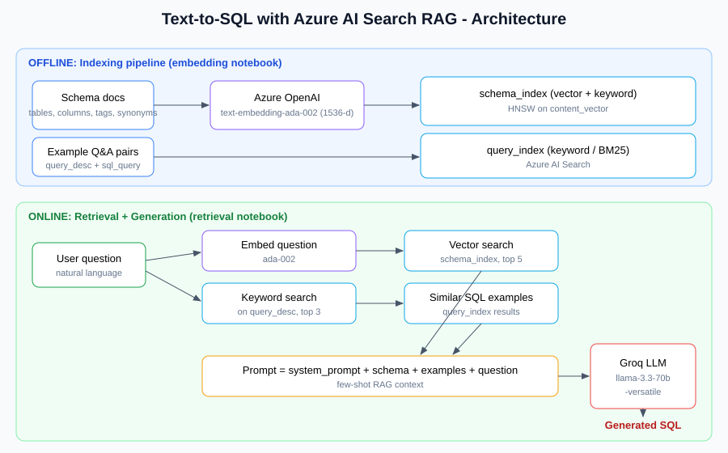
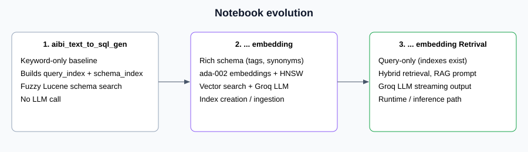
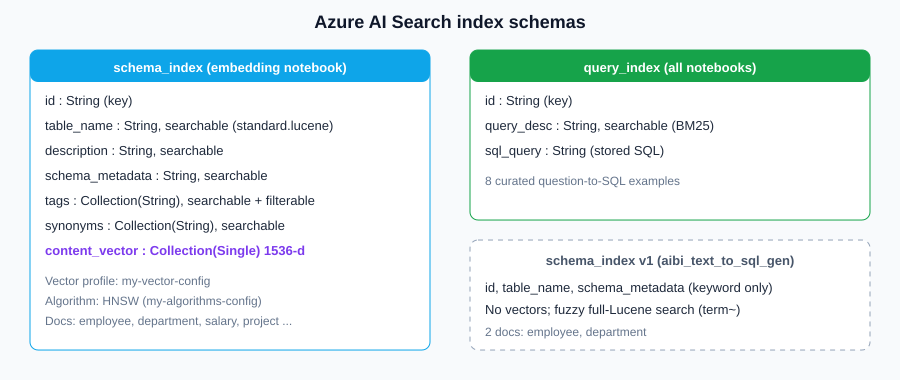

# Text-to-SQL using Azure AI Search (RAG)

A set of Jupyter notebooks that convert natural-language questions into SQL using **Retrieval-Augmented Generation (RAG)**.
Table schemas and curated example queries are stored in **Azure AI Search**. At question time the most relevant schema and examples are retrieved and passed to an LLM (**Llama 3.3 70B on Groq**), which writes the SQL.

## Contents

1. [Architecture](#architecture)
2. [Notebook overview](#notebook-overview)
3. [Notebook details](#notebook-details)
4. [Azure AI Search indexes](#azure-ai-search-indexes)
5. [Sample data](#sample-data)
6. [End-to-end flow](#end-to-end-flow)
7. [Setup and configuration](#setup-and-configuration)
8. [Known issues and improvements](#known-issues-and-improvements)

---

## Architecture



| Layer | Technology |
|---|---|
| Embeddings | Azure OpenAI `text-embedding-ada-002` (1536 dimensions) |
| Vector and keyword store | Azure AI Search (`azure-search-documents==11.4.0`) |
| Vector algorithm | HNSW |
| LLM | Groq `llama-3.3-70b-versatile` (streaming) |
| Language | Python 3.11 (Jupyter) |

## Notebook overview



| # | Notebook | Cells | Purpose |
|---|---|---|---|
| 1 | `aibi_text_to_sql_gen.ipynb` | 10 | Baseline. Builds keyword-only indexes and tests search. No embeddings, no LLM. |
| 2 | `aibi_text_to_sql_gen embedding.ipynb` | 25 | Full indexing pipeline. Adds rich schema metadata, embeddings, a vector index, vector search, and an LLM call. |
| 3 | `aibi_text_to_sql_gen embedding Retrival.ipynb` | 12 | Runtime only. Assumes the indexes already exist. Retrieves context and calls the LLM. |

Recommended order: run **2** once to build the indexes, then use **3** for question answering. Notebook **1** is the earlier keyword-only prototype.

---

## Notebook details

### 1. `aibi_text_to_sql_gen.ipynb` - keyword-search baseline

Creates two Azure AI Search indexes and queries them with plain text search.

| Cell | What it does |
|---|---|
| 0-1 | Imports: `openai`, `azure.storage.blob`, `pickle`, `numpy`, and the Azure Search SDK classes. |
| 2 | Defines `query_documents`: 8 example pairs of `query_desc` and `sql_query`. |
| 3 | Creates **`query_index`** with fields `id` (key), `query_desc` (searchable) and `sql_query`. |
| 4 | Uploads the 8 example queries. |
| 5 | Defines a minimal `schema_documents` list for 2 tables (`employee`, `department`). |
| 6 | Creates **`schema_index`** with `id`, `table_name` and `schema_metadata`, using the `standard.lucene` analyzer. |
| 7 | Uploads the schema documents. |
| 8 | `query_search(query_text, top_k=3)`: BM25 keyword search over `query_index`. |
| 9 | `schema_search(query_text, top_k=2)`: full-Lucene fuzzy search (`employee~`) over `schema_index`. |

Limitation: matching is purely lexical, so a question like "staff" will not find the `employee` table.

### 2. `aibi_text_to_sql_gen embedding.ipynb` - indexing + vector search

The main build notebook.

| Cell | What it does |
|---|---|
| 0 | `pip install openai azure-search-documents==11.4.0`. |
| 1-2 | Imports (index models, `VectorSearch`, `HnswAlgorithmConfiguration`, `SearchClient`, and others). |
| 3 | `query_documents`: 8 curated example SQL queries (a commented-out earlier copy sits above it). |
| 4 | Creates **`query_index`** (keyword). |
| 5 | Uploads the example queries. |
| 6 | `schema_documents`: richer metadata for the tables `employee`, `department`, `salary` and `project`. Each has a `description`, column descriptions, `tags` and `synonyms`. |
| 8 | Creates **`schema_index`** with an added `content_vector` field (1536-d, HNSW profile `my-vector-config`). |
| 9 | Builds an `AzureOpenAI` client and `generate_embeddings(texts)` using `text-embedding-ada-002`. |
| 10 | Concatenates `table_name + description + schema_metadata + tags + synonyms` for each table, embeds the text and stores it in `content_vector`. |
| 11-12 | Inspects a sample embedding. |
| 13-14 | Uploads the schema documents, with vectors, to `schema_index`. |
| 15 | Sets `user_query = "get the count of employees in each department"`. |
| 16 | `schema_search()`: embeds the question and runs a `VectorizedQuery` (k=5, top 5) against `content_vector`. |
| 17 | `query_search()`: keyword search over `query_index` (top 3). |
| 19-20 | Defines `system_prompt` with placeholders `{predefined_queries}` and `{schema_result}`. |
| 21-22 | Installs `groq`, then calls `llama-3.3-70b-versatile` (temperature 1, 1024 max tokens, streamed). |

### 3. `aibi_text_to_sql_gen embedding Retrival.ipynb` - runtime retrieval + generation

A lean notebook for inference. It makes no index changes.

| Cell | What it does |
|---|---|
| 0-1 | Imports. |
| 2 | Azure OpenAI client and `generate_embeddings()`. |
| 3-4 | Connects to Azure AI Search and creates a `SearchClient` for the schema index. |
| 5 | `user_query = "get the those dept which does not have any employee"`. |
| 6 | `schema_search()` (vector search). Output: the `department` table (score 0.80), then `employee`. |
| 7 | `query_search()` (keyword search). Top hit: `query_006`, "employees who do not belong to any department" (score 5.14). |
| 8-9 | Defines and displays `system_prompt`. |
| 10 | Streams the Groq LLM response. The model answered with a `LEFT JOIN ... WHERE e.dept_id IS NULL` query. |

---

## Azure AI Search indexes



### `schema_index` (vector + keyword)

| Field | Type | Notes |
|---|---|---|
| `id` | String | Key |
| `table_name` | String | Searchable, `standard.lucene` |
| `description` | String | Searchable |
| `schema_metadata` | String | Searchable. Holds table and column descriptions. |
| `tags` | Collection(String) | Searchable and filterable |
| `synonyms` | Collection(String) | Searchable |
| `content_vector` | Collection(Single) | 1536 dimensions, HNSW |

### `query_index` (keyword)

| Field | Type | Notes |
|---|---|---|
| `id` | String | Key |
| `query_desc` | String | Searchable. Plain-English description of the query. |
| `sql_query` | String | Reference SQL used as a few-shot example. |

## Sample data

**Tables**

| Table | Columns |
|---|---|
| `employee` | `emp_id` (PK), `emp_name`, `emp_salary`, `dept_id` (FK to `department`) |
| `department` | `dept_id` (PK), `dept_name` |
| `salary` | `salary_id` (PK), `emp_id` (FK to `employee`), `amount`, `pay_date` |
| `project` | project details (in the embedding notebook only) |

**Example queries (`query_index`)**

| ID | Description |
|---|---|
| query_001 | All employees with their department names |
| query_002 | Highest-paid employee |
| query_003 | Employee count per department |
| query_004 | Total salary expense per department |
| query_005 | Employees earning more than 70,000 |
| query_006 | Employees with no department |
| query_007 | Average salary per department |
| query_008 | Employees whose name starts with "J" |

## End-to-end flow

1. **Index (once):** embed each table's description, columns, tags and synonyms with ada-002, then upload to `schema_index`. Upload the example Q&A pairs to `query_index`.
2. **Ask:** the user submits a natural-language question.
3. **Retrieve schema:** embed the question, then run a vector search on `schema_index` (top 5).
4. **Retrieve examples:** run a keyword search on `query_index` (top 3).
5. **Prompt:** combine the system prompt, retrieved schema and similar SQL examples with the question.
6. **Generate:** Groq `llama-3.3-70b-versatile` returns the SQL.

## Setup and configuration

```bash
pip install openai azure-search-documents==11.4.0 groq
```

Fill in these values in the notebooks. Keep them out of source control, and prefer environment variables.

| Setting | Where |
|---|---|
| `azure_endpoint`, `api_key`, `api_version` | Azure OpenAI client |
| `model = "text-embedding-ada-002"` | Your embedding deployment name |
| `search_service_name`, `admin_api_key` | Azure AI Search |
| `Groq(api_key=...)` | Groq API key |

## Known issues and improvements

- **The prompt is never filled in.** `system_prompt` still contains the literal `{predefined_queries}` and `{schema_result}`, because nothing calls `.format()` on it. The retrieved context never reaches the LLM. In the retrieval notebook the model even replies that it does not have the schema and assumes one. Fix by building the prompt from the search results with `.format()` or an f-string.
- `schema_search` returns a streaming result iterator. It is consumed by the print loop, so the returned value is empty when reused. Convert it with `list(results)` first.
- Cell 3 of the retrieval notebook defines the search service name and API key twice.
- The `schema_index` is created in the embedding notebook with a service name hard-coded in one cell. Move all settings into one config cell or a `.env` file.
- Retrieval could be improved with hybrid search (keyword + vector) and semantic ranking. The semantic options are already present as commented-out code.
- `temperature=1` is high for SQL generation. Use 0 to 0.2 for more deterministic output.
- Add SQL validation (for example a dry run or `EXPLAIN`) and read-only database credentials before executing generated SQL.
